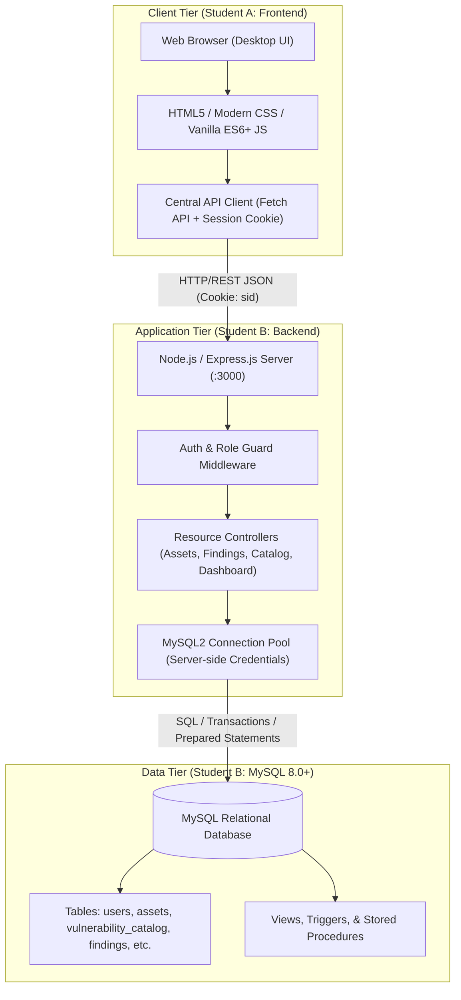
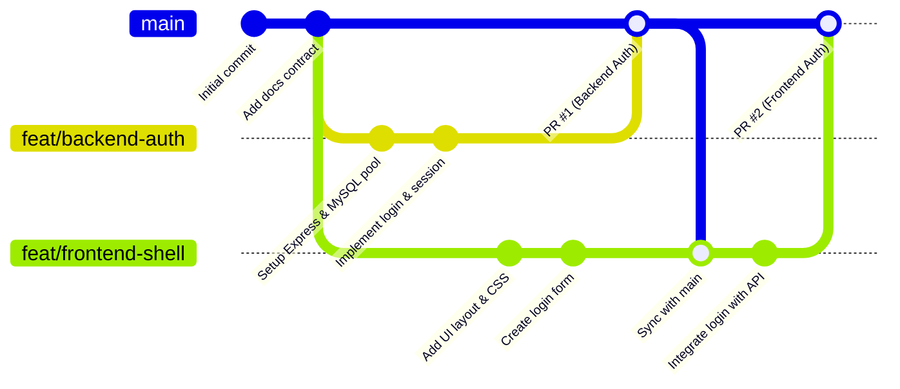

# VulnTrack: System Architecture & Integration Agreement

**Project Name:** VulnTrack — Vulnerability Tracking & Remediation Management System  
**Document Version:** 1.0.0 (Pre-Implementation Baseline)  
**Authors:** Student A (Frontend & Integration Lead) & Student B (Backend & Database Lead)  
**Target Repository:** Single Public GitHub Monorepo (`vulntrack`)  

---

## 1. Executive Summary & Architectural Philosophy

VulnTrack is a practical, web-based vulnerability management and remediation tracking system designed for university enterprise security contexts. The platform enables security analysts to inventory IT assets, catalog standard vulnerability definitions (CVE/CWE references), record vulnerability instances ("findings") against specific assets, enforce a strict remediation lifecycle through a deterministic state machine, and monitor organizational risk posture via an analytical dashboard.

### Core Architectural Principles
1. **Student-Understandable Monolithic 3-Tier Design:** A clean, predictable 3-tier architecture (Client Tier, Application/API Tier, Database Tier) running locally without distributed systems overhead.
2. **Explicit Anti-Scope (What We Are NOT Building):**
   - **No Microservices:** The application runs as a cohesive, single-process Express.js backend.
   - **No Live Scanner Engine:** We are **not** building or simulating an active network scanner (e.g., Nmap or Nessus runner) via Node subprocesses. Findings represent discovered vulnerabilities imported or manually logged by analysts.
   - **No Unnecessary Databases:** No Redis, MongoDB, or message brokers (Kafka/RabbitMQ). All state, relational data, sessions, and analytical metrics are handled natively by MySQL 8.0+.
   - **Contract-First Development:** Frontend and backend developers work against mutually agreed specifications defined in `docs/` before writing code.



---

## 2. Agreed Technology Stack

| Layer | Selected Technology | Version / Tooling | Rationale & Trade-offs |
| :--- | :--- | :--- | :--- |
| **Frontend UI** | HTML5, CSS3, JavaScript (ES6+) | Vanilla (No build step) | Eliminates React/Vue build toolchain complexity (`npm run build`, Webpack/Vite), allowing instantaneous hot-reload via static serving, direct DOM debugging, and clean evaluation by academic examiners. Modern CSS variables provide clean theming. |
| **Backend API** | Node.js with Express.js | Node 18+ / 20+ LTS, Express 4.19+ | Lightweight, asynchronous, well-documented, and native JSON handling. Standard choice for student full-stack systems. |
| **Database** | MySQL Server | 8.0+ (InnoDB Engine) | Industry-standard relational DBMS. Fully supports ACID transactions, foreign key constraints, CHECK constraints, triggers, stored procedures, and complex analytical aggregations. |
| **Database Driver** | `mysql2/promise` | ^3.9+ | Provides native Promise support for `async/await`, efficient connection pooling, and strict parameterized queries to prevent SQL injection. |
| **Password Hashing**| `bcryptjs` | ^2.4+ | Pure JavaScript implementation of bcrypt for cross-platform compatibility without native C++ compilation issues on Windows/Linux. |
| **Session Store** | `express-session` + `express-mysql-session` | Latest LTS | Secure server-side sessions stored directly in MySQL. Avoids token storage pitfalls in client-side storage. |
| **Version Control** | Git & GitHub | Git 2.40+, GitHub Public Repo | Distributed version control, feature branch isolation, pull request peer reviews, and automated commit history tracking. |

---

## 3. Security, Authentication & Session Strategy

### The Golden Rule: Zero DB Credentials in Frontend
> [!CAUTION]
> **Database credentials (DB host, user, password, port) must NEVER exist in client-side code, HTML, or public Git history.**
> The frontend browser communicates exclusively over HTTP/REST JSON with Express. The Express server alone connects to MySQL using credentials stored in a local `.env` file that is git-ignored.

### Authentication & Session Lifecycle
1. **Login Submission:** The user enters credentials on `/login.html`. Frontend sends `POST /api/auth/login` with JSON payload `{ "usernameOrEmail": "...", "password": "..." }`.
2. **Credential Verification:** Express controller queries `users` table via parameterized SQL: `SELECT * FROM users WHERE username = ? OR email = ?`. Password verification is performed using `bcrypt.compare(password, user.password_hash)`.
3. **Session Issuance:**
   - Express initializes a server-side session object (`req.session.user = { id, username, role, full_name }`).
   - Session metadata is persisted to the `sessions` table in MySQL via `express-mysql-session`.
   - Express sets a signed session cookie on the response:
     - `name`: `vulntrack_sid`
     - `httpOnly`: `true` (prevents JavaScript/XSS access to session token)
     - `sameSite`: `'lax'` (mitigates Cross-Site Request Forgery - CSRF)
     - `secure`: `false` in local development (`true` in production HTTPS)
     - `maxAge`: `86400000` (24 hours)
4. **Subsequent API Requests:**
   - The browser automatically attaches `Cookie: vulntrack_sid=...` to all requests when `fetch()` is called with `credentials: 'include'`.
   - Express authentication middleware (`requireAuth`) verifies session validity and populates `req.user`.
   - Role-authorization middleware (`requireRole('admin')`, `requireRole('analyst')`) guards privileged endpoints.
5. **App Bootstrap Check:** On every page load, frontend calls `GET /api/auth/me`. If a valid 200 response is returned, the UI renders the authenticated user navbar; if 401 is returned, the UI redirects to `/login.html`.
6. **Logout:** User clicks Logout. Frontend calls `POST /api/auth/logout`. Express destroys the session in MySQL, clears the client cookie, and returns `200 OK`.

### Architectural Comparison: Cookie Sessions vs. JWT in LocalStorage

| Criterion | Cookie Sessions (Selected) | JWT in `localStorage` (Rejected) |
| :--- | :--- | :--- |
| **XSS Vulnerability** | **Secure:** `HttpOnly` cookie cannot be read by malicious client-side JS. | **Insecure:** Any injected script can read `localStorage.getItem('token')`. |
| **Instant Revocation**| **Immediate:** Deleting session in MySQL revokes access on the next request. | **Difficult:** JWTs remain valid until expiration unless a blacklist DB is maintained. |
| **Implementation Complexity** | Simple, native to Express & browser `fetch`. | Requires manual Authorization headers on every client fetch call. |
| **Academic Clarity** | Teaches relational session persistence in MySQL. | Adds redundant cryptographic payload inspection. |

---

## 4. Repository Structure & Code Ownership

To avoid merge conflicts and streamline collaboration, strict module ownership is established.

```
vulntrack/
├── docs/                           # [SHARED] Architectural specs & contracts
│   ├── api-contract.md
│   ├── database-design.md
│   ├── architecture.md
│   ├── implementation-plan.md
│   └── dbms-coverage-matrix.md
├── backend/                        # [STUDENT B DOMAIN: Backend & MySQL]
│   ├── src/
│   │   ├── config/                 # DB connection pool, session configuration
│   │   │   ├── db.js
│   │   │   └── session.js
│   │   ├── controllers/            # Route business logic & SQL execution
│   │   │   ├── authController.js
│   │   │   ├── assetController.js
│   │   │   ├── catalogController.js
│   │   │   ├── findingController.js
│   │   │   └── dashboardController.js
│   │   ├── middleware/             # Auth checks, validation, error handlers
│   │   │   ├── authMiddleware.js
│   │   │   ├── validateMiddleware.js
│   │   │   └── errorMiddleware.js
│   │   ├── routes/                 # Express Router endpoint definitions
│   │   │   ├── authRoutes.js
│   │   │   ├── assetRoutes.js
│   │   │   ├── catalogRoutes.js
│   │   │   ├── findingRoutes.js
│   │   │   └── dashboardRoutes.js
│   │   └── server.js               # Express application entrypoint
│   ├── sql/
│   │   ├── schema.sql              # DDL: Tables, Views, Triggers, Stored Procedures
│   │   └── seed.sql                # DML: Optional fictional local development data
│   ├── .env.example                # Template for environment variables
│   └── package.json                # Backend dependencies
├── frontend/                       # [STUDENT A DOMAIN: Frontend & Integration]
│   ├── css/
│   │   ├── main.css                # Global styles, variables, typography
│   │   ├── layout.css              # Navbar, sidebar, card grids
│   │   └── components.css          # Badges, modals, tables, forms, buttons
│   ├── js/
│   │   ├── api.js                  # Centralized HTTP fetch client & error handler
│   │   ├── auth.js                 # Login/logout & route guarding logic
│   │   ├── dashboard.js            # Metrics display & SVG/canvas chart rendering
│   │   ├── findings.js             # Finding list, filter/sort & transition actions
│   │   ├── catalog.js              # Catalog browser & lookup modal
│   │   └── assets.js               # Asset inventory management
│   ├── pages/                      # HTML views (served statically)
│   │   ├── index.html              # Dashboard view
│   │   ├── login.html              # Authentication view
│   │   ├── findings.html           # Findings table & detail view
│   │   ├── catalog.html            # Vulnerability catalog view
│   │   └── assets.html             # Asset inventory view
│   └── assets/                     # Static assets (logos, icons)
├── .gitignore                      # Shared git ignore configuration
└── README.md                       # Shared project runbook & setup instructions
```

### File Boundary Rules
- **Student A (Frontend Lead):** Exclusive owner of `frontend/`. Can refactor UI styles, HTML structures, and client JS anytime. Does **not** modify `backend/` files.
- **Student B (Backend Lead):** Exclusive owner of `backend/`. Can refactor controllers, middleware, SQL queries, and table triggers anytime. Does **not** modify `frontend/` files.
- **Shared / Protected Files (Mutual Agreement Required):**
  - `docs/*`: The contract must only be edited after both developers discuss and approve changes.
  - `.gitignore`, `backend/package.json` (for shared tools), and root `README.md`.

---

## 5. Git & Collaboration Workflow

Both developers will collaborate in the single public GitHub repository (`vedang-05/vulntrack`) using a structured, lightweight Git feature-branch workflow.



### Workflow Rules
1. **`main` Branch is Sacred:**
   - Code on `main` must always build, run, and pass smoke tests. Direct commits to `main` are prohibited.
2. **Branch Naming Standard:**
   - Features: `feat/<student>-<feature-name>` (e.g., `feat/sa-findings-ui`, `feat/sb-state-machine`)
   - Fixes: `fix/<student>-<bug-name>` (e.g., `fix/sb-sql-join-error`, `fix/sa-modal-backdrop`)
3. **Commit Messages (Conventional Commits):**
   - Format: `<type>(<scope>): <concise message in present tense>`
   - Examples:
     - `feat(auth): implement bcrypt login and session storage`
     - `fix(findings): correct status transition trigger validation`
     - `docs(api): add query parameters for findings filter`
4. **Pull Requests (PR) & Mandatory Peer Review:**
   - When a feature is complete, open a PR against `main`.
   - **Student A must review Student B's PRs:** Verifies that API responses match the contract in `docs/api-contract.md`.
   - **Student B must review Student A's PRs:** Verifies that frontend requests use correct routes, HTTP methods, and payload structures.
   - At least 1 peer approval is required before merging.
5. **Pre-Merge Smoke Checklist:**
   - Does `npm start` boot without throwing exceptions?
   - Does the app operate cleanly on an empty database (no seed data required)?
   - Are there any hardcoded secrets or passwords committed?

---

## 6. Seed Data & Environment Policy

1. **Empty Database First:** The application must boot, connect, and allow a user to register/login and create assets, catalog items, and findings on a **completely empty database**. An empty state is not an error state.
2. **Optional Fictional Local Seed Data:**
   - File: `backend/sql/seed.sql`
   - Purpose: Quick manual testing and viva demonstrations only.
   - Constraints: All data must be fictional (e.g., assets named `srv-finance-01.corp.internal`, fictional IP addresses `10.0.1.15`, CVE references from public NVD catalogs).
   - Passwords in `seed.sql` must use pre-hashed standard strings (e.g., bcrypt hash for `Password123!`).
3. **Environment Isolation:**
   - Backend loads secrets via `dotenv` from `backend/.env`.
   - `.env` is listed in `.gitignore` and **must never be committed**.
   - `backend/.env.example` provides default configuration values for local setup:
     ```ini
     PORT=3000
     DB_HOST=localhost
     DB_PORT=3306
     DB_USER=root
     DB_PASSWORD=your_password_here
     DB_NAME=vulntrack_db
     SESSION_SECRET=vulntrack_dev_secret_change_in_prod_12345
     NODE_ENV=development
     ```

---

## 7. Trade-offs & Unresolved Decisions

### Explicitly Evaluated Trade-offs
1. **Single Monolith vs. Microservices:**
   - *Decision:* Monolithic single Express server.
   - *Rationale:* Eliminates network partition failures, multiple deployment steps, service discovery, and container orchestration overhead during student presentations.
2. **Database Triggers vs. Application Logic for Audit Trail:**
   - *Decision:* Database Triggers + Stored Procedures for status transitions.
   - *Rationale:* Satisfies university DBMS syllabus criteria for active database mechanisms while guaranteeing audit integrity even if SQL statements are executed outside the application.
3. **Static File Serving Strategy:**
   - *Decision:* Express serves static files from `frontend/` in development via `express.static('../frontend')`.
   - *Rationale:* Allows running the complete stack with a single `npm start` command on `localhost:3000` without CORS configuration.

### Unresolved Decisions for Team Discussion
- [ ] **Decision U-1 (Email Notification Simulation):** Should we log simulated email alerts to the console when a finding breaches SLA, or keep SLA tracking purely visual on the dashboard? *(Recommendation: Keep it purely visual on the dashboard to avoid fake mock services).*
- [ ] **Decision U-2 (CSV Export Feature):** Should finding export to CSV be performed directly in browser JavaScript or via a backend streaming route `GET /api/findings/export`? *(Recommendation: Backend streaming route to demonstrate SQL cursor / pagination).*
- [ ] **Decision U-3 (Initial Admin Bootstrapping):** Should the first registered user automatically be assigned the `admin` role, or should the database schema seed an initial `admin` account with a forced password change? *(Recommendation: Seed default admin in `schema.sql` with documented dev credentials).*
