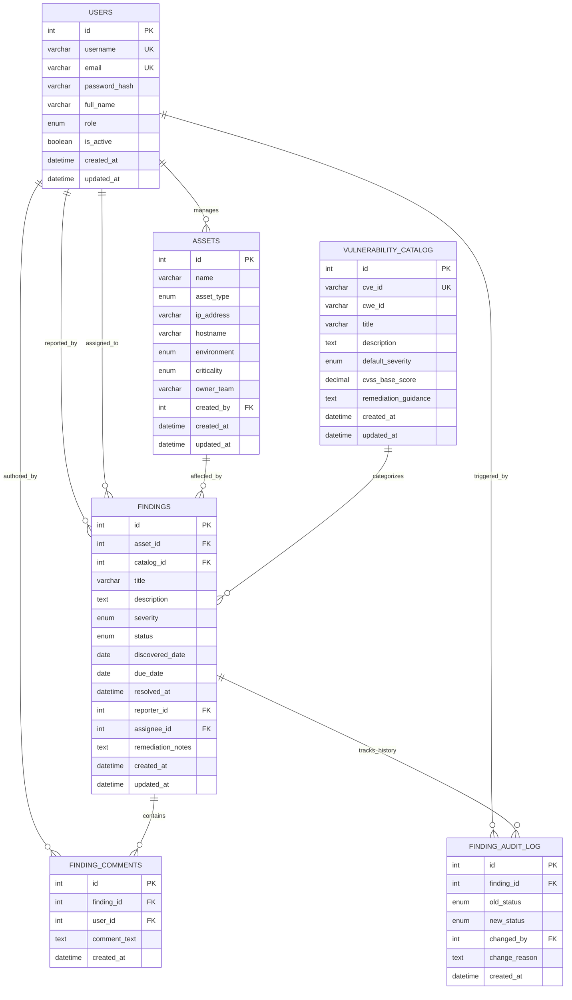

# VulnTrack: Relational Database Design Specification

**Database Engine:** MySQL 8.0+ (Storage Engine: InnoDB)  
**Default Character Set:** `utf8mb4`  
**Collation:** `utf8mb4_unicode_ci`  
**Author:** Student B (Backend & Database Lead)  
**Reviewed by:** Student A (Frontend & Integration Lead)  

---

## 1. Relational Entity Overview

VulnTrack's data model enforces a strict separation between **known vulnerability catalog definitions** (templates/advisories) and **concrete vulnerability findings** (instances detected on specific IT assets).



---

## 2. Table Schemas, Constraints & DDL

### 2.1 Table: `users`
Stores user identities, hashed credentials, and role authorizations.

| Column | Type | Constraints | Description |
| :--- | :--- | :--- | :--- |
| `id` | `INT` | `AUTO_INCREMENT`, `PRIMARY KEY` | Unique user identifier |
| `username` | `VARCHAR(50)` | `NOT NULL`, `UNIQUE` | Unique login username |
| `email` | `VARCHAR(100)`| `NOT NULL`, `UNIQUE` | Contact email address |
| `password_hash`| `VARCHAR(255)`| `NOT NULL` | Bcrypt password hash string |
| `full_name` | `VARCHAR(100)`| `NOT NULL` | Display name of the user |
| `role` | `ENUM(...)` | `NOT NULL`, Default: `'developer'` | Role: `'admin'`, `'analyst'`, `'developer'` |
| `is_active` | `BOOLEAN` | `NOT NULL`, Default: `TRUE` | Soft disable flag |
| `created_at` | `DATETIME` | `NOT NULL`, Default: `CURRENT_TIMESTAMP` | Account creation timestamp |
| `updated_at` | `DATETIME` | `NOT NULL`, Default: `CURRENT_TIMESTAMP ON UPDATE CURRENT_TIMESTAMP` | Last updated timestamp |

### 2.2 Table: `assets`
Maintains the inventory of systems, servers, applications, and network infrastructure.

| Column | Type | Constraints | Description |
| :--- | :--- | :--- | :--- |
| `id` | `INT` | `AUTO_INCREMENT`, `PRIMARY KEY` | Unique asset ID |
| `name` | `VARCHAR(100)`| `NOT NULL` | Friendly name (e.g., `prod-db-cluster-01`) |
| `asset_type` | `ENUM(...)` | `NOT NULL` | `'SERVER'`, `'WEB_APP'`, `'DATABASE'`, `'NETWORK'`, `'CLOUD_RESOURCE'` |
| `ip_address` | `VARCHAR(45)` | `NULL` | IPv4 or IPv6 address |
| `hostname` | `VARCHAR(255)`| `NULL`, `UNIQUE` | FQDN or DNS hostname |
| `environment` | `ENUM(...)` | `NOT NULL`, Default: `'DEVELOPMENT'` | `'PRODUCTION'`, `'STAGING'`, `'DEVELOPMENT'` |
| `criticality` | `ENUM(...)` | `NOT NULL`, Default: `'MEDIUM'` | Business impact: `'CRITICAL'`, `'HIGH'`, `'MEDIUM'`, `'LOW'` |
| `owner_team` | `VARCHAR(100)`| `NOT NULL` | Department or team responsible (e.g., `SecOps`) |
| `created_by` | `INT` | `NOT NULL`, `FOREIGN KEY REFERENCES users(id)` | User who registered the asset |
| `created_at` | `DATETIME` | `NOT NULL`, Default: `CURRENT_TIMESTAMP` | Record creation timestamp |
| `updated_at` | `DATETIME` | `NOT NULL`, Default: `CURRENT_TIMESTAMP ON UPDATE CURRENT_TIMESTAMP` | Last modification timestamp |

### 2.3 Table: `vulnerability_catalog`
The master dictionary of standard vulnerability definitions (templates). **Independent of any asset.**

| Column | Type | Constraints | Description |
| :--- | :--- | :--- | :--- |
| `id` | `INT` | `AUTO_INCREMENT`, `PRIMARY KEY` | Catalog entry ID |
| `cve_id` | `VARCHAR(30)` | `NULL`, `UNIQUE` | Standard CVE identifier (e.g., `CVE-2021-44228`) |
| `cwe_id` | `VARCHAR(30)` | `NULL` | CWE categorization (e.g., `CWE-89` SQLi) |
| `title` | `VARCHAR(200)`| `NOT NULL` | Standard vulnerability title |
| `description`| `TEXT` | `NOT NULL` | Technical overview and root cause |
| `default_severity`| `ENUM(...)` | `NOT NULL` | Base severity: `'CRITICAL'`, `'HIGH'`, `'MEDIUM'`, `'LOW'`, `'INFO'` |
| `cvss_base_score` | `DECIMAL(3,1)`| `CHECK (cvss_base_score BETWEEN 0.0 AND 10.0)` | CVSS v3.1 score |
| `remediation_guidance` | `TEXT` | `NULL` | Generic vendor patch or configuration fix |
| `created_at` | `DATETIME` | `NOT NULL`, Default: `CURRENT_TIMESTAMP` | Catalog creation timestamp |
| `updated_at` | `DATETIME` | `NOT NULL`, Default: `CURRENT_TIMESTAMP ON UPDATE CURRENT_TIMESTAMP` | Last updated timestamp |

### 2.4 Table: `findings`
A concrete instance of a vulnerability discovered on a specific asset.

| Column | Type | Constraints | Description |
| :--- | :--- | :--- | :--- |
| `id` | `INT` | `AUTO_INCREMENT`, `PRIMARY KEY` | Unique finding ID |
| `asset_id` | `INT` | `NOT NULL`, `FOREIGN KEY REFERENCES assets(id) ON DELETE RESTRICT` | Target asset affected |
| `catalog_id`| `INT` | `NOT NULL`, `FOREIGN KEY REFERENCES vulnerability_catalog(id) ON DELETE RESTRICT` | Associated catalog definition |
| `title` | `VARCHAR(200)`| `NOT NULL` | Specific instance title (defaults to catalog title) |
| `description`| `TEXT` | `NULL` | Specific discovery details (e.g., port, parameter) |
| `severity` | `ENUM(...)` | `NOT NULL` | Contextual severity: `'CRITICAL'`, `'HIGH'`, `'MEDIUM'`, `'LOW'`, `'INFO'` |
| `status` | `ENUM(...)` | `NOT NULL`, Default: `'OPEN'` | Lifecycle state: `'OPEN'`, `'IN_PROGRESS'`, `'UNDER_REVIEW'`, `'CLOSED'`, `'FALSE_POSITIVE'`, `'RISK_ACCEPTED'`, `'REOPENED'` |
| `discovered_date` | `DATE` | `NOT NULL`, Default: `(CURDATE())` | Date finding was detected |
| `due_date` | `DATE` | `NOT NULL` | Remediation deadline based on SLA |
| `resolved_at` | `DATETIME` | `NULL` | Timestamp when finding transitioned to `'CLOSED'` |
| `reporter_id` | `INT` | `NOT NULL`, `FOREIGN KEY REFERENCES users(id) ON DELETE RESTRICT` | Analyst who logged the finding |
| `assignee_id` | `INT` | `NULL`, `FOREIGN KEY REFERENCES users(id) ON DELETE SET NULL` | Developer assigned to remediate |
| `remediation_notes` | `TEXT` | `NULL` | Technical details on fix or mitigation |
| `created_at` | `DATETIME` | `NOT NULL`, Default: `CURRENT_TIMESTAMP` | Record creation timestamp |
| `updated_at` | `DATETIME` | `NOT NULL`, Default: `CURRENT_TIMESTAMP ON UPDATE CURRENT_TIMESTAMP` | Last updated timestamp |

### 2.5 Table: `finding_audit_log`
Append-only audit trail capturing all state transitions and management interventions.

| Column | Type | Constraints | Description |
| :--- | :--- | :--- | :--- |
| `id` | `INT` | `AUTO_INCREMENT`, `PRIMARY KEY` | Audit log entry ID |
| `finding_id` | `INT` | `NOT NULL`, `FOREIGN KEY REFERENCES findings(id) ON DELETE CASCADE` | Associated finding |
| `old_status` | `ENUM(...)` | `NULL` | Previous status before change |
| `new_status` | `ENUM(...)` | `NOT NULL` | Updated status |
| `changed_by` | `INT` | `NOT NULL`, `FOREIGN KEY REFERENCES users(id) ON DELETE RESTRICT` | User who authorized transition |
| `change_reason` | `TEXT` | `NOT NULL` | Mandatory explanation (especially for FP / Risk Accept) |
| `created_at` | `DATETIME` | `NOT NULL`, Default: `CURRENT_TIMESTAMP` | Audit timestamp |

### 2.6 Table: `finding_comments`
Discussion thread between analysts and remediators.

| Column | Type | Constraints | Description |
| :--- | :--- | :--- | :--- |
| `id` | `INT` | `AUTO_INCREMENT`, `PRIMARY KEY` | Comment ID |
| `finding_id` | `INT` | `NOT NULL`, `FOREIGN KEY REFERENCES findings(id) ON DELETE CASCADE` | Finding thread |
| `user_id` | `INT` | `NOT NULL`, `FOREIGN KEY REFERENCES users(id) ON DELETE RESTRICT` | Author |
| `comment_text`| `TEXT` | `NOT NULL` | Message body |
| `created_at` | `DATETIME` | `NOT NULL`, Default: `CURRENT_TIMESTAMP` | Timestamp |

---

## 3. Referential Integrity & Deletion Rules

1. **`ON DELETE RESTRICT` on Assets & Catalog:**
   - An asset **cannot** be deleted if it has associated findings.
   - A vulnerability catalog entry **cannot** be deleted if findings link to it.
   - *Rationale:* Protects historic vulnerability tracking data from accidental cascading data loss.
2. **`ON DELETE SET NULL` on Finding Assignee:**
   - If a developer user account is removed or deactivated, findings assigned to them do not disappear; `assignee_id` becomes `NULL`, alerting the security team that the finding is unassigned.
3. **`ON DELETE CASCADE` on Comments & Audit Log:**
   - If a finding is deleted (strictly an admin action for duplicate cleanup), its associated comment threads and audit entries are automatically cleaned up to prevent orphaned child rows.

---

## 4. Database Views

### View 1: `v_active_findings_detail`
Flattens relational joins between findings, assets, catalog items, and assigned users to provide a fast, ready-to-render view for the frontend findings table.

```sql
CREATE OR REPLACE VIEW v_active_findings_detail AS
SELECT 
    f.id AS finding_id,
    f.title AS finding_title,
    f.severity,
    f.status,
    f.discovered_date,
    f.due_date,
    f.resolved_at,
    CASE 
        WHEN f.status NOT IN ('CLOSED', 'FALSE_POSITIVE', 'RISK_ACCEPTED') AND f.due_date < CURDATE() THEN 1 
        ELSE 0 
    END AS is_overdue,
    DATEDIFF(CURDATE(), f.due_date) AS days_overdue,
    a.id AS asset_id,
    a.name AS asset_name,
    a.asset_type,
    a.environment,
    a.criticality AS asset_criticality,
    vc.id AS catalog_id,
    vc.cve_id,
    vc.cwe_id,
    reporter.full_name AS reporter_name,
    assignee.id AS assignee_id,
    assignee.full_name AS assignee_name
FROM findings f
INNER JOIN assets a ON f.asset_id = a.id
INNER JOIN vulnerability_catalog vc ON f.catalog_id = vc.id
INNER JOIN users reporter ON f.reporter_id = reporter.id
LEFT JOIN users assignee ON f.assignee_id = assignee.id;
```

### View 2: `v_asset_risk_summary`
Aggregates risk metrics per asset to identify hot-spots in the enterprise infrastructure.

```sql
CREATE OR REPLACE VIEW v_asset_risk_summary AS
SELECT 
    a.id AS asset_id,
    a.name AS asset_name,
    a.environment,
    a.criticality,
    COUNT(CASE WHEN f.status NOT IN ('CLOSED', 'FALSE_POSITIVE') THEN 1 END) AS active_findings_count,
    COUNT(CASE WHEN f.status NOT IN ('CLOSED', 'FALSE_POSITIVE') AND f.severity = 'CRITICAL' THEN 1 END) AS critical_count,
    COUNT(CASE WHEN f.status NOT IN ('CLOSED', 'FALSE_POSITIVE') AND f.severity = 'HIGH' THEN 1 END) AS high_count,
    COUNT(CASE WHEN f.status NOT IN ('CLOSED', 'FALSE_POSITIVE') AND f.due_date < CURDATE() THEN 1 END) AS overdue_count
FROM assets a
LEFT JOIN findings f ON a.id = f.asset_id
GROUP BY a.id, a.name, a.environment, a.criticality;
```

---

## 5. Stored Procedures & Transactions

### Stored Procedure: `sp_transition_finding_status`
Enforces the remediation state machine directly in the database engine using an explicit ACID transaction (`START TRANSACTION ... COMMIT / ROLLBACK`). Validates the transition, sets the `resolved_at` timestamp if closing, and records an entry in `finding_audit_log`.

```sql
DELIMITER //

CREATE PROCEDURE sp_transition_finding_status(
    IN p_finding_id INT,
    IN p_new_status VARCHAR(20),
    IN p_user_id INT,
    IN p_reason TEXT
)
proc_label: BEGIN
    DECLARE v_old_status VARCHAR(20);
    DECLARE v_is_valid INT DEFAULT 0;

    -- Exit on error with rollback
    DECLARE EXIT HANDLER FOR SQLEXCEPTION
    BEGIN
        ROLLBACK;
        RESIGNAL;
    END;

    START TRANSACTION;

    -- 1. Fetch current status with row-level locking
    SELECT status INTO v_old_status 
    FROM findings 
    WHERE id = p_finding_id 
    FOR UPDATE;

    IF v_old_status IS NULL THEN
        SIGNAL SQLSTATE '45000' SET MESSAGE_TEXT = 'Finding not found.';
    END IF;

    -- 2. State Machine Transition Validation Matrix
    IF v_old_status = 'OPEN' AND p_new_status IN ('IN_PROGRESS', 'FALSE_POSITIVE', 'RISK_ACCEPTED') THEN
        SET v_is_valid = 1;
    ELSEIF v_old_status = 'IN_PROGRESS' AND p_new_status IN ('UNDER_REVIEW', 'OPEN') THEN
        SET v_is_valid = 1;
    ELSEIF v_old_status = 'UNDER_REVIEW' AND p_new_status IN ('CLOSED', 'IN_PROGRESS') THEN
        SET v_is_valid = 1;
    ELSEIF v_old_status = 'CLOSED' AND p_new_status = 'REOPENED' THEN
        SET v_is_valid = 1;
    ELSEIF v_old_status = 'REOPENED' AND p_new_status IN ('IN_PROGRESS', 'FALSE_POSITIVE', 'RISK_ACCEPTED') THEN
        SET v_is_valid = 1;
    ELSEIF v_old_status = 'FALSE_POSITIVE' AND p_new_status = 'OPEN' THEN
        SET v_is_valid = 1;
    ELSEIF v_old_status = 'RISK_ACCEPTED' AND p_new_status = 'OPEN' THEN
        SET v_is_valid = 1;
    END IF;

    IF v_is_valid = 0 THEN
        SIGNAL SQLSTATE '45000' 
        SET MESSAGE_TEXT = 'Invalid state machine transition requested.';
    END IF;

    -- 3. Update Finding Status and timestamp
    IF p_new_status = 'CLOSED' THEN
        UPDATE findings 
        SET status = p_new_status, 
            resolved_at = NOW(), 
            updated_at = NOW() 
        WHERE id = p_finding_id;
    ELSE
        UPDATE findings 
        SET status = p_new_status, 
            resolved_at = NULL, 
            updated_at = NOW() 
        WHERE id = p_finding_id;
    END IF;

    -- 4. Record Audit Log Entry
    INSERT INTO finding_audit_log (finding_id, old_status, new_status, changed_by, change_reason, created_at)
    VALUES (p_finding_id, v_old_status, p_new_status, p_user_id, p_reason, NOW());

    COMMIT;
END //

DELIMITER ;
```

---

## 6. Indexing Strategy

To maintain sub-10ms query execution times as findings scale:

```sql
-- 1. Foreign Key Performance Indexes (prevents table scans during JOINs)
CREATE INDEX idx_findings_asset_id ON findings(asset_id);
CREATE INDEX idx_findings_catalog_id ON findings(catalog_id);
CREATE INDEX idx_findings_assignee_id ON findings(assignee_id);
CREATE INDEX idx_findings_reporter_id ON findings(reporter_id);

-- 2. Composite Index for Dashboard Status/Severity breakdown
CREATE INDEX idx_findings_status_severity ON findings(status, severity);

-- 3. Composite Index for Overdue SLA Queries
CREATE INDEX idx_findings_sla ON findings(status, due_date);

-- 4. Search Index for Catalog CVE Lookups
CREATE INDEX idx_catalog_cve ON vulnerability_catalog(cve_id);
```

---

## 7. Normalization Analysis (1NF to BCNF)

| Normal Form | Compliance Verification |
| :--- | :--- |
| **1NF (First Normal Form)** | Every column contains atomic (indivisible) scalar values. There are no repeating groups or comma-separated lists (e.g., assignees and comments are stored in dedicated relational tables). Every table has a well-defined primary key. |
| **2NF (Second Normal Form)** | Satisfies 1NF. All tables utilize single-column surrogate primary keys (`id`). Therefore, partial functional dependencies (where a non-key attribute depends on part of a composite key) are structurally impossible. |
| **3NF (Third Normal Form)** | Satisfies 2NF. No transitive dependencies exist ($X \to Y$ and $Y \to Z$). For example, finding records store only `catalog_id` rather than repeating `cve_id`, `description`, or `cvss_score`. Asset details (`ip_address`, `criticality`) live solely in `assets`. |
| **BCNF (Boyce-Codd Normal Form)**| For every functional dependency $X \to Y$, $X$ is a superkey (the primary key or unique candidate key). E.g., in `users`, `username \to id, email` and `email \to id, username`, both of which are unique keys. |
