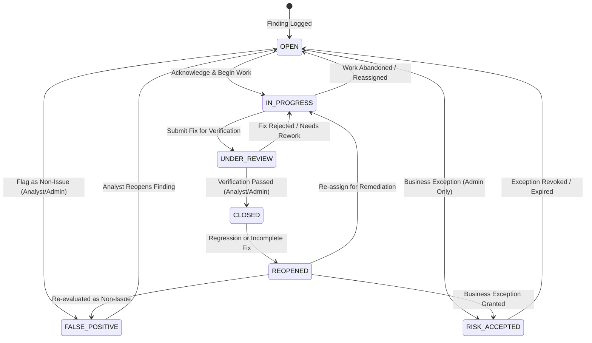
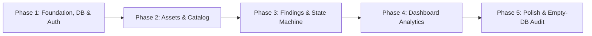

# VulnTrack: Implementation Plan & Metrics Specification

**Project:** VulnTrack  
**Document Version:** 1.0.0  
**Co-Authors:** Student A (Frontend & Integration) & Student B (Backend & Database)  

---

## 1. Remediation State Machine Specification

The core business logic of VulnTrack is the remediation lifecycle. To maintain enterprise accountability and prevent developers from prematurely marking vulnerabilities as resolved without independent verification, state transitions are enforced deterministically.



### 1.1 State Definitions

| State Name | Definition & Context | Active in Risk Score? |
| :--- | :--- | :--- |
| `OPEN` | Newly reported vulnerability awaiting assignment or triage. | **Yes** |
| `IN_PROGRESS` | Assigned to a developer/sysadmin; remediation currently underway. | **Yes** |
| `UNDER_REVIEW` | Developer has deployed a candidate fix; awaiting security analyst verification. | **Yes** |
| `CLOSED` | Security analyst has confirmed the vulnerability is mitigated and verified. | **No** |
| `FALSE_POSITIVE` | Determined to be non-exploitable, invalid, or an inaccurate assessment. | **No** |
| `RISK_ACCEPTED` | Business leadership has formally approved leaving the issue unpatched (with documented rationale). | **No** |
| `REOPENED` | A previously closed finding has resurfaced during re-testing or regression. | **Yes** |

### 1.2 Allowed State Transition Matrix

| From State | To State | Authorized Roles | Mandatory Justification? | Automated Side Effect |
| :--- | :--- | :--- | :--- | :--- |
| `OPEN` | `IN_PROGRESS` | `admin`, `analyst`, `developer` | No | Log transition in `finding_audit_log` |
| `OPEN` | `FALSE_POSITIVE` | `admin`, `analyst` | **Yes (min 10 chars)** | Exclude from active metrics |
| `OPEN` | `RISK_ACCEPTED` | `admin` only | **Yes (min 15 chars)** | Exclude from active metrics |
| `IN_PROGRESS` | `UNDER_REVIEW` | `admin`, `analyst`, `developer` | **Yes (fix notes)** | Notifies analyst queue |
| `IN_PROGRESS` | `OPEN` | `admin`, `analyst`, `developer` | No | Reset assignment |
| `UNDER_REVIEW` | `CLOSED` | `admin`, `analyst` only | **Yes (verification notes)**| Sets `resolved_at = NOW()` |
| `UNDER_REVIEW` | `IN_PROGRESS` | `admin`, `analyst` only | **Yes (rejection notes)** | Clears `resolved_at` |
| `CLOSED` | `REOPENED` | `admin`, `analyst` only | **Yes (regression notes)**| Clears `resolved_at`, resets SLA |
| `REOPENED` | `IN_PROGRESS` | `admin`, `analyst`, `developer` | No | Remediation resumes |
| `FALSE_POSITIVE`| `OPEN` | `admin`, `analyst` only | **Yes** | Returns to active queue |
| `RISK_ACCEPTED` | `OPEN` | `admin` only | **Yes** | Returns to active queue |

### 1.3 Forbidden Transitions (Enforced by Database & API)
- ❌ **`OPEN` $\to$ `CLOSED`:** A finding cannot be marked closed directly upon discovery. It must pass through `UNDER_REVIEW` verification.
- ❌ **`IN_PROGRESS` $\to$ `CLOSED`:** A remediator cannot self-certify and close their own finding.
- ❌ **`CLOSED` $\to$ `IN_PROGRESS`:** A closed finding cannot silently resume work; it must be formally transitioned to `REOPENED` to track regression history.
- ❌ **Direct transition from `FALSE_POSITIVE` to `CLOSED`:** An issue cannot be both invalid and closed.

---

## 2. Dashboard Metrics & SQL Aggregation Specifications

Every metric displayed on the executive dashboard corresponds to a precise, reproducible SQL query against the MySQL database.

### Metric 1: Total Active Findings
- **Definition:** Count of all vulnerabilities currently posing an active risk to the organization.
- **SQL Query:**
  ```sql
  SELECT COUNT(*) AS total_active
  FROM findings
  WHERE status NOT IN ('CLOSED', 'FALSE_POSITIVE', 'RISK_ACCEPTED');
  ```
- **UI Element:** Primary KPI Counter Card (Neutral / Blue badge).

---

### Metric 2: Critical & High Priority Open Vulnerabilities
- **Definition:** Count of open findings requiring immediate attention according to SLA policy.
- **SQL Query:**
  ```sql
  SELECT 
      SUM(CASE WHEN severity = 'CRITICAL' THEN 1 ELSE 0 END) AS critical_count,
      SUM(CASE WHEN severity = 'HIGH' THEN 1 ELSE 0 END) AS high_count
  FROM findings
  WHERE status NOT IN ('CLOSED', 'FALSE_POSITIVE', 'RISK_ACCEPTED');
  ```
- **UI Element:** Critical Alert Indicator (Red / Orange badge).

---

### Metric 3: Findings Breakdown by Severity
- **Definition:** Distribution of active findings across severity classifications.
- **SQL Query:**
  ```sql
  SELECT 
      severity, 
      COUNT(*) AS count
  FROM findings
  WHERE status NOT IN ('CLOSED', 'FALSE_POSITIVE')
  GROUP BY severity
  ORDER BY FIELD(severity, 'CRITICAL', 'HIGH', 'MEDIUM', 'LOW', 'INFO');
  ```
- **UI Element:** Horizontal Bar Chart or Donut Chart.

---

### Metric 4: Findings Breakdown by Status
- **Definition:** Operational status of all findings in the system across the remediation lifecycle.
- **SQL Query:**
  ```sql
  SELECT 
      status, 
      COUNT(*) AS count
  FROM findings
  GROUP BY status
  ORDER BY FIELD(status, 'OPEN', 'IN_PROGRESS', 'UNDER_REVIEW', 'CLOSED', 'FALSE_POSITIVE', 'RISK_ACCEPTED', 'REOPENED');
  ```
- **UI Element:** Multi-column Status Pipeline Card or Pie Chart.

---

### Metric 5: Mean Time to Remediate (MTTR)
- **Definition:** Average number of calendar days taken from finding discovery to resolution for closed findings.
- **SQL Query:**
  ```sql
  SELECT 
      ROUND(AVG(DATEDIFF(resolved_at, discovered_date)), 1) AS mttr_days
  FROM findings
  WHERE status = 'CLOSED' 
    AND resolved_at IS NOT NULL;
  ```
- **UI Element:** KPI Metric Card with Trend Indicator (Days).

---

### Metric 6: Overdue / SLA Breached Findings Count
- **Definition:** Active findings that have surpassed their remediation due date without being closed or exempted.
- **SQL Query:**
  ```sql
  SELECT COUNT(*) AS overdue_count
  FROM findings
  WHERE status NOT IN ('CLOSED', 'FALSE_POSITIVE', 'RISK_ACCEPTED')
    AND due_date < CURDATE();
  ```
- **UI Element:** Warning Banner / Alert Card (Urgent Attention Required).

---

### Metric 7: Top 5 Vulnerable Assets
- **Definition:** Infrastructure targets with the highest concentration of unresolved security issues.
- **SQL Query:**
  ```sql
  SELECT 
      a.id AS asset_id,
      a.name AS asset_name,
      a.environment,
      a.criticality,
      COUNT(f.id) AS open_findings_count,
      SUM(CASE WHEN f.severity IN ('CRITICAL', 'HIGH') THEN 1 ELSE 0 END) AS high_critical_count
  FROM assets a
  INNER JOIN findings f ON a.id = f.asset_id
  WHERE f.status NOT IN ('CLOSED', 'FALSE_POSITIVE', 'RISK_ACCEPTED')
  GROUP BY a.id, a.name, a.environment, a.criticality
  ORDER BY high_critical_count DESC, open_findings_count DESC
  LIMIT 5;
  ```
- **UI Element:** High-risk Assets Leaderboard Table with direct drill-down links.

---

## 3. Implementation Phasing & Milestones

The project is structured into 5 sequential phases. Each phase establishes clean, verifiable integration checkpoints between Student A and Student B.



### Phase 1: Foundation, DB Schema & Authentication
- **Student B (Backend/DB):**
  - Create database `vulntrack_db` and write `backend/sql/schema.sql` (Tables: `users`, `sessions`).
  - Configure MySQL connection pool (`mysql2/promise`) in `backend/src/config/db.js`.
  - Implement `POST /api/auth/login`, `POST /api/auth/logout`, and `GET /api/auth/me`.
  - Provide `backend/.env.example`.
- **Student A (Frontend/Integration):**
  - Create frontend layout shell: global CSS variables, responsive typography, responsive navbar.
  - Implement `frontend/pages/login.html` with form submission script.
  - Implement `frontend/js/api.js` (fetch wrapper with `credentials: 'include'`).
- **Milestone 1 Verification:**
  - Launch app on clean DB, log in with seeded or created user, confirm session cookie set in DevTools, refresh page, confirm `GET /api/auth/me` auto-populates user info.

---

### Phase 2: Assets & Vulnerability Catalog Management
- **Student B (Backend/DB):**
  - Add tables `assets` and `vulnerability_catalog` to `schema.sql`.
  - Implement CRUD routes and controllers for `/api/assets` and `/api/catalog`.
  - Enforce role validation (`admin`/`analyst` for write ops, `admin` for delete).
- **Student A (Frontend/Integration):**
  - Implement `frontend/pages/assets.html` (table of assets, search/filter bar, add/edit modal).
  - Implement `frontend/pages/catalog.html` (lookup directory of standard CVE/CWEs).
  - Wire frontend modals to `POST` and `PUT` endpoints.
- **Milestone 2 Verification:**
  - Register 2 new assets (e.g. Web Server, Database) and 2 catalog entries (e.g. SQL Injection, XSS) via the UI; confirm MySQL tables contain records with correct foreign keys and timestamps.

---

### Phase 3: Findings Management & State Machine
- **Student B (Backend/DB):**
  - Add tables `findings`, `finding_audit_log`, and `finding_comments` to `schema.sql`.
  - Implement Stored Procedure `sp_transition_finding_status` in MySQL.
  - Implement routes for `GET /api/findings`, `POST /api/findings`, `PATCH /api/findings/:id/status`.
  - Implement routes for `GET/POST /api/findings/:id/comments` and `GET /api/findings/:id/history`.
- **Student A (Frontend/Integration):**
  - Implement `frontend/pages/findings.html` (interactive data table with severity badges, status tags, SLA warnings).
  - Implement Finding Detail Modal with State Transition button dropdown (dynamically displays only valid transitions based on current state).
  - Implement Transition Reason Modal (prompts user for justification text before firing `PATCH`).
  - Implement Comments and Audit History timeline view.
- **Milestone 3 Verification:**
  - Log a finding as an Analyst; change status to `IN_PROGRESS`; submit fix as `UNDER_REVIEW`; verify as Analyst to `CLOSED`; verify audit trail captures all transitions with timestamps. Attempt forbidden jump `OPEN -> CLOSED` and confirm friendly error message.

---

### Phase 4: Analytical Dashboard & Aggregations
- **Student B (Backend/DB):**
  - Create database views `v_active_findings_detail` and `v_asset_risk_summary`.
  - Implement analytical endpoints: `/api/dashboard/stats`, `/by-severity`, `/by-status`, `/top-assets`, `/overdue`.
  - Add indexes (`idx_findings_status_severity`, `idx_findings_sla`) and run `EXPLAIN` to confirm index utilization.
- **Student A (Frontend/Integration):**
  - Implement `frontend/pages/index.html` (executive dashboard view).
  - Render KPI metric cards (Active Findings, Critical count, Overdue count, MTTR).
  - Implement responsive SVG or lightweight HTML/CSS bar/donut charts for severity and status distributions.
  - Implement Top Vulnerable Assets table with direct click-through filters.
- **Milestone 4 Verification:**
  - Add and resolve multiple findings across different assets; verify dashboard numbers match SQL manual counts; confirm MTTR updates accurately.

---

### Phase 5: End-to-End Integration, Empty-DB Verification & Viva Prep
- **Both Students Jointly:**
  - Drop the local database and recreate using ONLY `schema.sql`.
  - Verify complete application flow from scratch (zero initial records).
  - Test seed script (`seed.sql`) for optional demo data loading.
  - Review DBMS Coverage Matrix (`docs/dbms-coverage-matrix.md`) and prepare answers for viva questions.

---

## 4. Pre-Deployment Smoke Test Protocol

Before any code is merged into `main`, both students must execute this 7-step checklist:

| Step # | Test Action | Expected Result | Pass/Fail |
| :---: | :--- | :--- | :---: |
| 1 | Run `mysql -u root -p < backend/sql/schema.sql` on a fresh DB | All tables, views, triggers, and procedures created without syntax errors. | [ ] |
| 2 | Start server with `npm start` in `backend/` | Express boots on port 3000, connects to MySQL successfully. | [ ] |
| 3 | Navigate to `http://localhost:3000/` in clean browser | Redirects to `/login.html`. | [ ] |
| 4 | Log in with test admin credentials | Session cookie created; redirects to Dashboard showing clean 0-counts. | [ ] |
| 5 | Create an Asset and a Catalog item | Success toast displayed; tables in MySQL updated. | [ ] |
| 6 | Create a Finding and transition through state machine | Transitions succeed; forbidden transitions blocked with 422 error. | [ ] |
| 7 | Check Dashboard metrics | KPI counters reflect newly created findings in real time. | [ ] |
